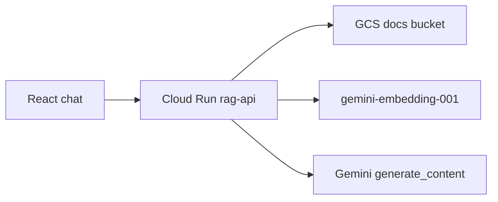
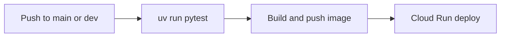

# Trading Desk Assistant

A FastAPI service on Cloud Run that answers from desk documents and can price a demo crude exposure. The React page calls the same API.

| | |
| --- | --- |
| API | https://rag-api-431360356117.me-central1.run.app |
| Dev API | https://rag-api-dev-dzyappblea-ww.a.run.app |
| Repo | https://github.com/aaami1ster/trading-assistant |
| Region | `me-central1` (Doha). Dammam, `me-central2`, is closed for this account. |

Pushing `main` deploys `rag-api` and `rag-web`. Pushing `dev` deploys `rag-api-dev` and `rag-web-dev`. The web image is built with `VITE_API_URL` pointed at the matching API.

## Run locally

```bash
gcloud auth login && gcloud auth application-default login
gcloud config set project trading-assistant-abdalla

cd api
uv sync
uv run uvicorn main:app --reload --host 127.0.0.1 --port 8080
```

In another terminal:

```bash
cd web
npm install
npm run dev
```

The Vite dev server proxies `/v1` to `http://127.0.0.1:8080`. Startup reads `gs://trading-assistant-abdalla-docs` and embeds the four sample notes, so the first launch needs Application Default Credentials and takes longer than `/health`.

```bash
curl -s http://127.0.0.1:8080/health
curl -s http://127.0.0.1:8080/v1/ask \
  -H 'content-type: application/json' \
  -d '{"question":"What is the Brent position limit per trader?"}'
curl -s http://127.0.0.1:8080/v1/agent \
  -H 'content-type: application/json' \
  -d '{"question":"What is our USD exposure on a 500,000 barrel Brent cargo?"}'
```

`uv run pytest` checks `/health` and a blank agent question. It does not load the bucket.

## Request path



`POST /v1/ask` retrieves the top 4 chunks and answers only from that text. `POST /v1/agent` lets the model call `get_price` and `calc_exposure`. Those prices are demo numbers: Brent 82.4, WTI 78.1, Dubai 80.9.

## CI/CD path



The pipeline is `cloudbuild.yaml`. Builds run as `rag-builder`. The API runs as `rag-api-sa`.

## Terraform

```bash
cd infra
terraform init
terraform plan \
  -var='project=trading-assistant-abdalla' \
  -var='image=me-central1-docker.pkg.dev/trading-assistant-abdalla/apps/rag-api:latest'
```

State is empty, so the plan proposes the service account, bucket, and Cloud Run service that `gcloud` already created. Do not apply that plan without importing those resources first.

## Decisions

- Chunks are 800 characters with a 150-character overlap. Vectors are normalized, so ranking is cosine similarity, and the API keeps 4 chunks.
- The prompt tells the model to say it does not know when the notes do not contain the answer. `sources` lists every retrieved file, not only the one cited in the sentence.
- The index lives in the process. A new instance reloads the bucket. A shared store for production is pgvector on AlloyDB or Vertex AI Vector Search.
- Production controls to name: IAP or SSO, that shared vector store, evals in the pipeline, and Model Armor.
- The exposure tools are read-only and use fake prices. A tool that could place or change a trade needs a person to confirm it outside the model loop.
- The container runs as uid 1000 and listens on `$PORT`. Dependencies come from `uv.lock`.
