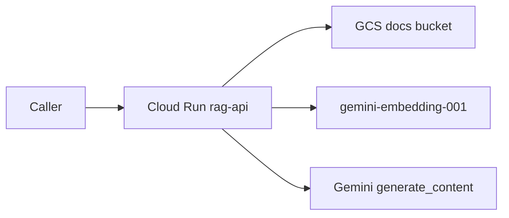

# Trading Desk Assistant — low-level design

Checked against `docs/Weekend Interview Prep — Senior SWE, AI & Cloud (GCP).pdf`, pages 11–18, on 31 Oct 2026. Project `trading-assistant-abdalla`. Repo: https://github.com/aaami1ster/trading-assistant.

The brief’s definition of done is a FastAPI + React app on Cloud Run that answers from trading documents and calls tools, deployed by Cloud Build on every Git push. The API, documents, agent route, and chat page are in the repo. The chat page reaches Cloud Run on the next push.

## Region

The brief uses `me-central2` (Dammam). This account cannot create resources there (`LOCATION_POLICY_VIOLATED`). Everything below runs in `me-central1` (Doha). In the interview, Dammam is still the data-residency answer. Say this demo runs in Doha because Dammam was closed for the account.

## What is running

| Piece | Value |
| --- | --- |
| Service | `rag-api` in `me-central1`, public. `rag-api-dev` from the `dev` branch, also public |
| URL | https://rag-api-431360356117.me-central1.run.app |
| Dev URL | https://rag-api-dev-dzyappblea-ww.a.run.app (`rag-api-dev-00001-kqh`, commit `a93427c`) |
| Runtime service account | `rag-api-sa@trading-assistant-abdalla.iam.gserviceaccount.com` (`roles/aiplatform.user`, object viewer on the docs bucket) |
| Builder service account | `rag-builder@trading-assistant-abdalla.iam.gserviceaccount.com` (Logs Writer, Cloud Run admin, Service Account User, Artifact Registry writer on `apps`) |
| Image | `me-central1-docker.pkg.dev/trading-assistant-abdalla/apps/rag-api:$SHORT_SHA` |
| Docs bucket | `gs://trading-assistant-abdalla-docs` in `me-central1` |
| GitHub connection | `trading-assistant-connection` in `me-central1`, repo resource `trading-assistant` |
| Triggers | `rag-api-main` on `^main$` deploys `rag-api`. `rag-api-dev` on `^dev$` sets `_SERVICE=rag-api-dev` |

A regional trigger cannot use the Google-managed Cloud Build account. Both triggers set `build.service_account` to `rag-builder`. The Cloud Build service agent has Service Account User on `rag-builder` so it can start the build. Logs are `CLOUD_LOGGING_ONLY`. Open a build that ran after Logs Writer was granted. Earlier builds have an empty log panel.

The first manual deploy also created Artifact Registry repo `cloud-run-source-deploy` in `me-central1`. The pipeline does not use it. Images go to `apps`.

## Request path



On startup, unless `PYTEST_CURRENT_TEST` is set, `load_bucket` lists `DOCS_BUCKET` (default `trading-assistant-abdalla-docs`), downloads each `.txt` and `.md` object, and calls `add_document`. A failure is logged and the process still serves `/health`. The index is a process-local list. A new instance, or scale above one, loads the bucket again. That is the demo store. For production, say pgvector on AlloyDB or Vertex AI Vector Search.

`POST /v1/ask` embeds the question, takes the top 4 chunks by cosine similarity, and asks Gemini to answer only from that text and to cite sources in brackets. The JSON `sources` field is every retrieved file, sorted, not only the file named in the answer. A blank question returns HTTP 422.

Chat model is `MODEL`, default `gemini-3.5-flash`, via the Vertex client in `location=global`. Confirm the model id in the Vertex model list before the interview. Embeddings use `gemini-embedding-001`.

## Documents

Copies live in `api/sample-docs/` and in the bucket:

| Object | Fact to ask |
| --- | --- |
| `desk-policy.txt` | Brent limit is 50,000 barrels per trader and 200,000 for the desk. Hedge a cargo the same day if its mark-to-market loss exceeds $250,000. |
| `incoterms-summary.txt` | Usual CIF grade is CIF Fujairah. The desk does not use DAP for crude. |
| `commodity-glossary.txt` | A barrel is 42 US gallons. Laycan is the loading window. |
| `crude-benchmarks.txt` | Cargo value is barrels times the benchmark price. The teaching example is 500,000 barrels at $80. |

Verified on the live service after commit `0de5530`:

```bash
curl -s https://rag-api-431360356117.me-central1.run.app/v1/ask \
  -H 'content-type: application/json' \
  -d '{"question":"What is the Brent position limit per trader?"}'
```

Answer cited `desk-policy.txt` and said 50,000 barrels. `sources` also listed the other retrieved files. A question that is not in the notes, such as the gold price in Tokyo, should be answered with “I don’t know.” The first request after a cold start can take about 15 seconds while the four files are embedded.

Pushing a new note to `main` deploys a new revision, which reloads the bucket. Upload the object before that revision starts, or the new instance indexes the bucket as it was at startup.

## CI/CD path

`cloudbuild.yaml` is the pipeline. A push to `main` runs it as `rag-api`. A push to `dev` runs the same file and deploys `rag-api-dev`.

1. `uv run --frozen pytest -q` in `api/`, with `GOOGLE_CLOUD_PROJECT` set. The health test does not load the bucket.
2. `docker build` of `api/` tagged `$SHORT_SHA`.
3. Push to `apps`.
4. `gcloud run deploy` of `_SERVICE` in `me-central1`, as `rag-api-sa`, with `GOOGLE_CLOUD_PROJECT` set, `--allow-unauthenticated`.

`origin/dev` is deployed. The trigger built commit `a93427c` into `rag-api-dev`.

## Status against the brief

| Step | State |
| --- | --- |
| 1. Project, APIs, Artifact Registry | Done in `me-central1`. Dammam is unavailable. |
| 2. FastAPI, health test, container | Done. Packaging is uv (`pyproject.toml`, `uv.lock`), not `requirements.txt`. Image is `ghcr.io/astral-sh/uv`, non-root, listens on `$PORT`. |
| 3. Cloud Run and `rag-api-sa` | Done. Public URL above. |
| 4. Cloud Build triggers | Done. `main` deploys `rag-api` and `rag-web`. `dev` deploys `rag-api-dev` and `rag-web-dev`. |
| 5. React chat page and CORS | Chat page is in `web/`. Vite proxies `/v1` locally. API allows `localhost:5173` and `https://rag-web…run.app`. The web Cloud Run service is created on the next pipeline run. |
| 6. RAG over Cloud Storage | Done. Four sample files, loaded at startup. |
| 7. Agent route | `POST /v1/agent` returns `{ "answer" }` from `run_agent`. ADK is not started. |
| 8. Terraform plan | `infra/variables.tf` declares `project` and `image`. Resources are one attribute per line, region `me-central1`. State is empty, so a plan proposes resources that `gcloud` already created. Do not apply that plan without importing them. |
| README | `README.md` has the URLs, both paths, and the decisions. |

## Still to do

The four checklist items are in the repo. What is not live yet:

1. Push `main` so Cloud Build deploys `rag-web` and the API revision that includes `POST /v1/agent` and CORS. A push to `dev` deploys `rag-web-dev` because the pipeline chooses the web service from `_SERVICE`.
2. ADK remains a stretch and is not started.

## Run locally

```bash
gcloud auth login && gcloud auth application-default login
gcloud config set project trading-assistant-abdalla
cd api
uv sync
uv run uvicorn main:app --reload --host 127.0.0.1 --port 8080
```

`.env` at the repo root sets `GOOGLE_CLOUD_PROJECT` and `MODEL`. Startup reads the same bucket as Cloud Run, using your user credentials. `uv run pytest` checks `/health` and a blank agent question, and skips the bucket.

The chat page is `cd web && npm run dev`. Vite proxies `/v1` to port 8080. The same routes work with curl:

```bash
curl -s http://127.0.0.1:8080/v1/ask \
  -H 'content-type: application/json' \
  -d '{"question":"What is the Brent position limit per trader?"}'
curl -s http://127.0.0.1:8080/v1/agent \
  -H 'content-type: application/json' \
  -d '{"question":"What is our USD exposure on a 500,000 barrel Brent cargo?"}'
```

## Decisions to say out loud

- **Chunk size.** 800 characters, step 650, overlap 150. Larger chunks are coarser. Smaller chunks cost more embeddings and carry less context.
- **Cosine.** Each vector is divided by its length, so the dot product is cosine similarity. Keep the top 4.
- **“Say you don’t know.”** The prompt forbids answers that are not in the retrieved text.
- **Evals.** Ten questions with expected answers. Score whether the cited file was actually retrieved.
- **Why the index is not shared.** It lives in the process. Scale-out and scale-to-zero rebuild it from the bucket. Production is pgvector or Vector Search.
- **Production sentence.** IAP or SSO, pgvector or Vector Search, evals in the pipeline, Model Armor.
- **Agent risk.** Both tools are read-only math on fake prices. A tool that could place or change a trade needs a human confirm step outside the model loop.
- **Image.** `USER 1000` so the process is not root. `$PORT` because Cloud Run injects it. uv instead of a slim image plus `requirements.txt`, with the lockfile installed by `uv sync --frozen`.
